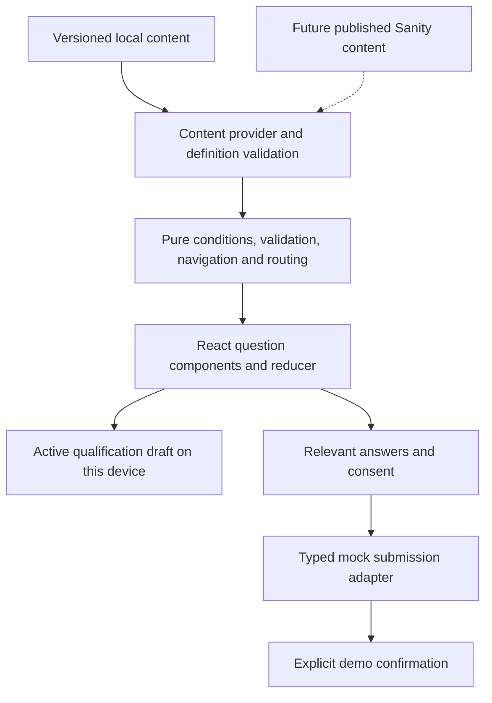

# Gradum conversational intake — implementation and walkthrough

## A. What was built

`/start` is a focused, bilingual conversation with one primary question at a time. It adapts to client/partner intent and professional category, offers stage progress, preserves qualification drafts on this device, supports Review/Edit, and demonstrates submission with a network-free mock adapter. The confirmation explicitly says the inquiry was **not** delivered.

General inquiry actions in desktop/mobile navigation, homepage hero/closing section, About, Consulting pages, Construction pages, and Services pages now enter the flow. The footer has a Start a Conversation link. Existing service-specific CTA wording and exploration links remain. The disabled Ventures/Accelerator workflows retain their separate contact-modal actions. The existing Resend endpoint is untouched.

CTA attribution uses an allowlist: homepage, consulting, construction, services, footer, navigation, about, direct. Unknown values become direct. Attribution never preselects an answer. Existing Vercel SPA rewrites include `/start`, including direct refreshes.

Design reference: Figma file `dChZ0b0OUoOUCt8gKUctoJ`, Interactive form page `337:1216`; desktop section `345:1143`; mobile section `348:1226`. See [discovery and decisions](intake-discovery.md).

## B. Architecture



| Responsibility | Source |
| --- | --- |
| Questions, stable option values, conditions, stages, routing | `src/features/intake/config/definition.ts` |
| Discriminated question union and provider contract data | `src/features/intake/config/types.ts` |
| English/Spanish copy registered in existing translations | `src/i18n/intake.ts`, `src/i18n/translations.ts` |
| Pure branching, navigation, active answers, review, routing, validation | `src/features/intake/engine/engine.ts` |
| Local/remote definition integrity boundary | `src/features/intake/engine/schema.ts` |
| Local provider and future provider interface | `src/features/intake/providers/content.ts` |
| Reducer, timers, draft lifecycle, analytics calls | `src/features/intake/hooks/useIntakeFlow.ts` |
| Local persistence, submission and analytics seams | `src/features/intake/services/` |
| Figma components, native controls and modal | `src/features/intake/components/IntakeControls.tsx` |
| Route and visual composition | `src/features/intake/pages/IntakePage.tsx`, `src/features/intake/intake.css` |

Questions carry stable ID, localized title/support, stage, input discriminator, required status, options or text constraints, visibility, review grouping, analytics ID, inline placement and optional interpolation. Only application-defined input types are supported; new content does not add executable behavior.

Conditions are serializable `equals`, `notEquals`, `includes`, `includesAny`, `includesAll`, `exists`, `all`, `any`, and `not`. They never execute JavaScript or HTML. Visibility evaluates in definition order using **active predecessors**, so stale hidden answers cannot enable another branch. Dependencies must point backward; cycles/forward references are rejected. Missing questions/options, duplicate IDs/options, unsupported types/stages, invalid routing/fallbacks, impossible branches and missing entry/contact/review termination are rejected before rendering.

Next means the first visible non-inline question after the current question. Back uses the actual visited path. The reducer keeps all session answers; Review, routing and submission derive only applicable ones. Inline follow-ups retain their own stable IDs without creating a second primary screen. Review rows group related work answers and project details through `reviewGroup`.

The route is lazy loaded. Existing site providers, Button, brand assets, fonts, CSS tokens, Framer Motion and easing are reused. The dedicated header intentionally replaces marketing chrome. The header line fills to each stage midpoint (10/30/50/70/90%), then 100% on confirmation. No total question count is shown.

### Persistence and privacy

`gradum:intake:draft:v1` stores definition version, saved timestamp, current question, visited path, active qualification answers, source and locale. It expires after seven days. Contact group and consent are **never** stored. Inactive branch answers stay only in memory and are not persisted. A resume dialog offers Resume or Start over; invalid, old-version, expired or corrupted drafts are discarded safely. Browser tab changes do not reset the reducer.

Qualification text can still contain personal information supplied by the visitor. It remains local to this browser profile and has the seven-day retention limit. Shared devices and browser storage remain a privacy tradeoff. No account, cross-device synchronization or email resume link exists. Storage failures produce a visible message; the session remains usable in memory. Users can always leave through normal browser controls.

## C. Complete user walkthrough

Example Partner → Engineering → Civil journey:

| Screen / ID | Example answer | Why it appears |
| --- | --- | --- |
| `q01_relationship` — How would you like to work with Gradum? | Partner | Shared root decision |
| `q02_work_category` — What best describes your work? | Engineering | Relationship is partner |
| `q03_engineering_specialty` — What's your primary engineering specialty? | Civil | Category is engineering |
| `q04_experience_years` — How long have you been practicing civil engineering? | More than 10 years | Partner qualification converges here; specialty is safely interpolated |
| `q05_coverage` — Where are you available to work? | Nationwide | Partner preferences; explicit Continue |
| `q06_project_interests` — What kinds of projects interest you? | Commercial, Infrastructure & civil works, Other | Partner preferences; multiple choices |
| `q06a_other_detail` — Tell us about other projects | Water & sanitation systems | Optional inline field because Other is selected |
| `q07_availability` — What's your current availability? | Within the next 30 days | Partner preferences |
| `q08_contact` — Let's stay in touch. | María Test, maria@example.com, +1 809 555 0142 | Shared contact group; all three required in Figma |
| `review` — Everything look right? | Check answers, then give inquiry consent | All applicable answers must validate |
| `confirmation` | Explicit demo result | Shown only after successful adapter resolution |

Nationwide selects Gran Santo Domingo, North/Cibao, East and South. It does not select Outside the Dominican Republic. Unchecking a local region clears Nationwide. Selecting all four local regions restores the shortcut.

Single choices advance after 450ms (150ms with reduced motion). Multi-selects, text and contact require Continue. Other engineering specialty reveals a required text field; Other projects reveals an optional text field. Both receive focus when revealed. Tab or Escape cancels pending advancement and exposes Continue. Revisiting any answered screen suppresses auto-advance.

Alternative: Partner → Construction shows `q03_construction_trade`, then `q03_construction_crew_size`, followed by experience and shared partner preferences. Architecture uses `q03_architecture_focus`; project management uses `q03_pm_scope` with certifications support; professional services uses `q03_services_area`; Something else uses `q03_other_description`. These minimal text prompts implement the named map branches without inventing option catalogs.

Client: Relationship → `c01_client_need` (Consulting / Construction / Services / Not sure yet) → shared contact → Review → demo confirmation. Figma marks detailed client consultation as next phase. No c02 questionnaires, budgets, timelines or project requirements were invented.

## D. Editing a branch

From Review, select Edit beside Your work. Engineering is preselected and Continue is explicit. Change it to Architecture, then Save and return to review. The engine first requests the newly required architecture focus, preserving the shared answers. After supplying it, Review shows Architecture and its focus; Civil no longer appears.

The Civil answer remains in reducer memory, so switching back to Engineering restores it in the same tab/session. It is excluded from the active review, routing and payload while Architecture is selected. A refresh restores only the active saved branch. Changing any answer clears consent; the final answers must be approved again.

When an edit makes no new required questions applicable, Save and return to review goes directly back to Review. Back never visits hidden engineering questions from the architecture path.

## E. Adding a question through configuration

For example, insert this **after** `q03_engineering_specialty_other_text` in `questions`. The following hypothetical content is an engineering example, not approved production copy:

```ts
{
  id: 'q03_engineering_delivery',
  analyticsId: 'q03_engineering_delivery',
  stage: 'work',
  type: 'single',
  presentation: 'options',
  title: { en: 'Which delivery setting suits you?', es: '¿Qué modalidad de trabajo prefieres?' },
  reviewLabel: { en: 'Delivery setting', es: 'Modalidad de trabajo' },
  reviewGroup: 'work',
  required: true,
  autoAdvance: true,
  visibleWhen: {
    all: [
      { questionId: 'q01_relationship', operator: 'equals', value: 'partner' },
      { questionId: 'q02_work_category', operator: 'equals', value: 'engineering' },
    ],
  },
  options: [
    { value: 'site', label: { en: 'On site', es: 'En obra' } },
    { value: 'remote', label: { en: 'Remote', es: 'A distancia' } },
  ],
}
```

In this repository, put both locale strings into `src/i18n/intake.ts` and reference them through the `copy` helper, so the established translation registry remains the content entry point. `required` and the option list enforce validation; serial order defines placement. Add a unit case for the new condition. No React or navigation change is needed. Increment the definition version when publishing a changed flow; old drafts then retire rather than being silently misinterpreted.

## F. Adding a branch

Add a stable category option to `q02_work_category`, then place its questions before the shared experience screen with a condition on relationship and the new category. Give each question bilingual content, supported type/constraints and `reviewGroup: 'work'`. Add a routing rule with an allowlisted mock destination. Run definition validation and branch tests. The renderer, reducer, Back behavior, Review and submission require no changes for supported question types.

Changing IDs or option values is a schema migration, not an editorial rename. New input behavior requires an explicitly implemented discriminated type, validator, renderer and tests.

## G. Sanity integration plan — not connected

No Sanity SDK, Studio, project, schema, credentials or remote provider was installed. The local provider is implemented; the following is the proposed migration.

| Proposed schema | Fields / editorial responsibilities |
| --- | --- |
| `intakeFlow` | Flow ID, immutable version, publication status, ordered stage/question references, terminal, routing references, explicit fallback |
| `intakeQuestion` | Stable ID, type, localized title/support/review label, stage, required, constraints, options, condition tree, inline parent, interpolation refs, review group, application-supported auto-advance flag |
| `intakeAnswerOption` | Stable value, localized label/description/mobile description, allowlisted icon ID, order |
| `intakeRoutingRule` | Stable rule ID, numeric priority, declarative condition, allowlisted team ID/category |
| `intakeConfirmation` | Localized confirmation and next-step content, reviewed separately for client/partner and live/mock modes |

Proposed published query (the final projection depends on the approved Studio schemas):

```groq
*[_type == "intakeFlow" && flowId == $flowId && version == $version
  && !(_id in path("drafts.**"))][0]{
  flowId, version, stages,
  "questions": questions[]->{...},
  "routing": routingRules[]->{...},
  fallback, confirmation->
}
```

Implement `sanityIntakeProvider.getPublishedDefinition(locale)` behind the existing interface. Fetch a pinned published version once, normalize references/localized fields to `IntakeDefinition`, resolve content keys, and call `assertDefinition` before returning. The normalization layer must allowlist fields rather than accepting executable expressions. The UI must not import a Sanity SDK.

Proposed environment names: `SANITY_PROJECT_ID`, `SANITY_DATASET`, pinned `SANITY_API_VERSION`, `SANITY_INTAKE_FLOW_ID`, `SANITY_INTAKE_VERSION`. For public datasets the project/dataset identifiers may be public; credentials must never be placed in `VITE_*` variables. Keep a private read/preview token (`SANITY_READ_TOKEN`/`SANITY_PREVIEW_TOKEN`) server-side if required. No write token belongs in the public intake.

Build an authenticated preview endpoint for draft content. Preview runs the same schema checks and branch tests; it is visibly labeled and cannot accept live inquiries. Studio field validation catches local shape errors; a publication gate runs full referential integrity, finite dependency reachability checks, route destination checks, translations and representative journey tests. Prevent publication on failure. Publish a new immutable definition version, pin the production backend/UI to it, retain prior versions for submission validation, and test before promoting the pin. Keep the last validated local/published fallback available for content-fetch failures; never render an unvalidated draft.

Questions/options/conditions/routing remain editorial data. Selection timing, focus behavior, input semantics, navigation, persistence, accessibility and transport remain application behavior. The current validator limits complex dependency combinations to avoid pathological CMS content. It requires backward dependencies and unconditional entry/contact/review termination rather than arbitrary graph execution.

## H. Submission and routing

The UI calls `IntakeSubmissionAdapter.submit` with a validated payload, abort signal and stable per-session idempotency key. Loading prevents duplicate clicks; unmount aborts pending work. Failure retains all answers and consent and offers Retry. Mock failure injection is a QA build setting, not an answer-dependent production trick: `VITE_INTAKE_MOCK_FAILURE=once`.

Synthetic example (abbreviated to the active answers for a client):

```json
{
  "flowId": "gradum-intake",
  "flowVersion": "1.0.0",
  "relationship": "client",
  "answers": {
    "q01_relationship": "client",
    "c01_client_need": "consulting",
    "q08_contact": {
      "name": "Example Visitor",
      "email": "visitor@example.com",
      "phone": "+1 809 555 0142"
    }
  },
  "visitedPath": ["q01_relationship", "c01_client_need", "q08_contact", "review"],
  "locale": "en",
  "source": "homepage",
  "submittedAt": "2026-11-04T21:00:00.000Z",
  "consent": { "inquiry": true, "at": "2026-11-04T21:00:00.000Z", "copyVersion": "1.0.0", "locale": "en" },
  "routing": {
    "destinationTeamId": "mock:consulting",
    "category": "consulting_inquiry",
    "matchedRuleId": "client_consulting",
    "flowVersion": "1.0.0",
    "fallback": false
  }
}
```

Routing sorts by descending priority, then stable rule ID to break ties. Each payload has one matched destination or `mock:general`. Team names are mock identifiers; no employees or inboxes were invented. Client consulting/construction/services resolve to the respective mock teams. Partner categories resolve to partnerships, with construction classified as a subcontractor inquiry.

Before production delivery, add a secure server endpoint that validates payload size/shape and flow version, reloads the authoritative published definition, validates applicable answers/consent and **recalculates routing**. Never trust a client-supplied destination. Configure actual approved team destinations server-side, access control, retention, rate limiting, bot protection, idempotent storage, authorized lead access, redacted audit logs, retries/dead-letter delivery handling and monitoring. Review consent/privacy copy and retention with the business before launch. The existing contact endpoint is unsuitable as a direct replacement until these contracts are implemented.

Analytics supports the eleven requested events through a vendor-neutral no-op adapter. It copies only version/question/stage/relationship/source/locale/routing-category metadata. It never sends answers or contact fields. Started/viewed effects deduplicate React Strict Mode replays. Connecting a vendor requires a consent-aware adapter; no tracking vendor was added.

## I. Verification results

See [verification record](intake-verification.md) for executed commands, counts and limitations. Screenshots are generated by `tests/intake.spec.ts` into `test-results/` at 1440 and 390px for visual comparison with individual Figma frames. No screenshots are used as application assets.

## J. Manual stakeholder testing guide

Start the site with `npm run dev`, open the displayed local URL, and use synthetic contact details. The screen states that this is a prototype. For each step below, success means the described screen/state appears. If it does not, record the current question, chosen option, screen width and browser; reload only after noting whether a draft exists.

1. **Enter from the website.** Click Start a Conversation in the navigation or homepage. Expect `/start?source=...` in the same tab and “How would you like to work with Gradum?” No answer should be preselected. If entry fails, try `/start` directly and report which CTA failed.
2. **Choose Partner.** Expect a selected border/background/check, then “What best describes your work?” after a short pause. Choose Engineering, then Civil. Expect the experience question to name civil engineering. If it skips a screen, go Back and record the selected answer.
3. **Try preferences.** Choose More than 10 years. Select Nationwide; all four local regions should check. Uncheck East; Nationwide should clear. Press Continue. Select Commercial and Other; the optional Other text field should appear. Enter “Water systems,” then Continue. If no Other field appears, uncheck/recheck Other and report it.
4. **Enter contact.** Choose Available now. Press Review answers while empty. Expect a specific error for each field and focus on Full name. Enter María Test, maria@example.com and +1 809 555 0142. Press Review answers. Expect only relevant answers. If contact errors remain after valid data, check for accidental spaces or a missing country code and record the message.
5. **Edit the branch.** On Review click Edit beside Your work. Choose Architecture and press Save and return to review. Expect architecture focus, not engineering specialty. Enter “Residential.” Save and return to review. Expect Architecture/Residential and no Civil. If Civil remains, capture that row and report it.
6. **Restore the old branch.** Edit Your work again and choose Engineering. Existing Civil should be restored in this session. Continue back to Review. If a new mandatory question appears, answer it; this is expected whenever a branch becomes newly applicable.
7. **Check consent and submission.** Press Send to Gradum without consent. Expect the specific consent error. Check the consent box and send. Expect Submitting to be disabled, then a personalized confirmation stating that no data was sent. If a failure appears, Retry should preserve all answers.
8. **Try the client path.** Return to Gradum, open Start a Conversation, choose Client, then Services. Expect contact immediately; no professional specialization, experience, coverage or interests. Fill synthetic contact and review. If partner questions appear, report the route/source and selected relationship.
9. **Save and resume.** On an unfinished conversation use Save & exit. Expect the device-only seven-day explanation. Keep going should dismiss it; Escape should also dismiss without leaving and restore focus. Reopen it and choose Save & exit to Gradum. Re-enter `/start`, choose Resume conversation, and expect qualification answers restored with contact empty. If no resume offer appears, check whether browser storage is disabled or seven days have passed.
10. **Start over.** Reload an unfinished draft and choose Start over. Expect a clear relationship screen. Corrupted/expired drafts should also recover to a fresh screen without crashing. Report any blank or inaccessible state.
11. **Keyboard and mobile.** Use Tab/arrow keys/Space/Enter on choices. Tab immediately after selection should stop automatic progression and expose Continue. Try 390px and 320px widths: cards stack, header is 64px, actions stay near the bottom, labels wrap and no sideways scrolling occurs. On a physical iPhone/Android device, focus email/phone and verify the keyboard does not cover the input or action bar. If it does, report OS/browser and field.
12. **Spanish.** Click ES at the bottom. Expect all intake controls, questions, validation and review labels to switch while answers remain. EN switches back. If anything is clipped, record the question and viewport size.
13. **Failure QA (developer-assisted).** Run `npm run test:intake:failure`, or start a separate development instance with `VITE_INTAKE_MOCK_FAILURE=once npm run dev`. Complete the client path. First submit fails visibly, answers stay, Retry succeeds. Use a normal build afterward for ordinary demos.

## K. Remaining work and explicit limits

- Approve Spanish translations, map-only partner prompts and detailed client consultation content. The English fully designed engineering path uses Figma copy/options.
- Figma production confirmation was corrected to show a demo result, avoiding a false delivery claim. Prototype labeling and draft privacy disclosure are intentional additions.
- Review uses Figma rows grouped by configuration; no employee-specific or real lead destinations are configured.
- Native radio semantics preserve standard left/right/up/down/Space behavior; Enter also selects/continues. Heading focus and concise live status avoid repeating the entire question twice.
- Sanity integration, authenticated preview, publishing gates, backend lead storage/delivery and vendor analytics remain planned, not installed or connected.
- No production deployment or real inquiry delivery was performed. Contact data exists only in the current tab's memory.
- Automated WebKit emulation cannot verify physical iOS/Android virtual keyboards or actual screen-reader speech. Perform VoiceOver/TalkBack and real-device acceptance before release. This is not a formal WCAG conformance certification.
- Runtime Node version should be upgraded to a Vite-supported version. The current build succeeds but emits a compatibility warning.

### Skills and host checks

Used the installed skills-library navigator, selecting `library/hosts/agents/skills/vercel-react-best-practices/SKILL.md` and `library/hosts/agents/skills/webapp-testing/SKILL.md` from plugin version 0.2.0. Used Figma's `figma-design-to-code` guidance for high-fidelity individual frame inspection. Existing TypeScript Playwright infrastructure was retained as requested, rather than creating a parallel Python test system. No skills-library helper/installer was run. Checked macOS, Node, installed dependencies, Chrome, local server permissions, Figma file access and downloaded SVG availability. The cached WebKit revision did not match Playwright; the matching WebKit runtime was downloaded into temporary task storage and tested. No external model, service provisioning, paid generation or agent delegation was used.
